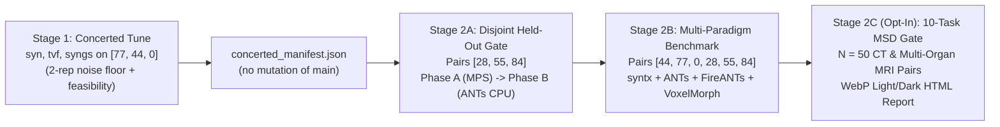

# Concerted Continuum Autotuning & Multi-Tier Benchmark Plan (`v6.43.0+`)

## 1. Scientific & Engineering Motivation

Between `v6.40.0` and `v6.43.0`, three foundational changes landed in `syntx`:

1. **Exact $O(d)$ Direction-Matrix Conjugation (`v6.42.0`, `src/syntx/core/regularizers.py`)**:
   Every coupled continuum Green's operator (`div_curl`, `navier`, `hyperelastic`, `solenoidal`, `poroelastic`, `masked_incompressible`) now conjugates displacement/velocity fields into physical coordinates via $D_{\text{zyx}} \mathcal{G}_{\mathbf{s}}(D_{\text{zyx}}^T \mathbf{v})$. Out-of-the-box on Mindboggle-101 pairs `[44, 77, 0]`, `syn_hyperelastic` jumped **`+1.04 pp` (`0.6193 -> 0.6297` symmetric NN Dice)** while minimum Jacobian determinants roughly doubled (`+0.059 -> +0.118` on `mbhard`).
2. **Centralized `FieldStepOptimizer`, `REGULARIZER_EXTRA_KEYS` & Single-Pass `RegAdam` (`v6.43.0`, `src/syntx/core/{optimizers,regularizers}.py`)**:
   Eliminated four systemic continuum-optimizer bugs across `greedy`, `syn`, `tvf`, and `syngs`:
   - `sobolev_alpha = 0.035` signature leakage into continuum regularizers (`0.26`-voxel starvation);
   - componentwise `Adam` variance division ($\mathbf{v} / \sqrt{\text{exp\_avg\_sq}}$) breaking $\nabla \cdot \mathbf{v}$ coupling in coupled PDE regularizers (now guarded centrally by `validate_regularizer_optimizer_pair`);
   - $H^4$ double-smoothing in `SyN` and `Greedy` `RegAdam` (now smoothed once post-quotient with exact per-axis anisotropic voxel step bounds); and
   - centralized `build_level_regularizer` / `REGULARIZER_EXTRA_KEYS` forwarding across all four solvers.
3. **`syntx.greedy` Proof-of-Concept (`v6.43.0`)**:
   Retuning `syntx.greedy` under the repaired physics produced a confirmed 2-rep feasible winner (`regularizer='div_curl'`, `optimizer='cfl'`, `learning_rate=1.5`, `cfl_momentum=0.1875`, `flow_sigma=1.62`), lifting 3-pair mean DKT31 NN Dice from **`0.5846` (`v6.42.0`) to `0.6041` (`+1.95 pp`, `0.0000%` folding)** — surpassing `FireANTs` `[100, 100, 50]` (`0.5894`) by **`+1.47 pp`** and matching classical symmetric `sobolev` `SyN` at unidirectional `[100, 100, 20]` speed.

Because every historical `best_parameters.json` record for **`syn`**, **`tvf`**, and **`syngs`** predates both `v6.42.0`'s $O(3)$ continuum conjugation and `v6.43.0`'s centralized `FieldStepOptimizer` / single-pass `RegAdam` refactor, those three bidirectional/geodesic solvers now sit on an untapped continuum performance ceiling.

---

## 2. Concerted Experimental Design (Zero Data Leakage, Zero GPU Contention)

Tuning and benchmarking are coupled in `scripts/concerted_tune_and_benchmark.py` so that:
- **No tuning pair ever grades promotion**: Hyperparameter search runs strictly on `--tune-pairs 77 44 0`; default-change eligibility is gated on a **100% subject-disjoint** held-out Mindboggle-101 validation set (`--heldout-pairs 28 55 84`, or 6-pair `28 33 51 55 68 84`) per `GEMINI.md` §6.
- **Identical shared affines & pyramid schedule**: Every deformable evaluation during tuning and held-out validation uses the SHA-256-verified cached affine `results/canonical_affines/pair_{pair:03d}_pt7_affine.mat` and fixed `reg_iterations = [100, 100, 20]`, isolating the deformable solver and regularizer.
- **Strict hardware isolation (`GEMINI.md` §4)**: Sequential single-process MPS jobs (Phase A) finish completely before multi-core CPU `ants.registration` jobs (Phase B) begin, avoiding Metal contention and pinned ITK thread inheritance.

### Subject-Disjoint Pair Partition (`examples/pairs.csv`)

| Split | Pair Index | Type | Fixed (`cohort1/subject1`) | Moving (`cohort2/subject2`) | Role |
|---|---:|---|---|---|---|
| **Tune** | `77` | `inter` | `OASIS-TRT-20/OASIS-TRT-20-5` | `MMRR-21/MMRR-21-8` | Anisotropic cross-site (`PIR -> LAI`) |
| **Tune** | `44` | `inter` | `NKI-TRT-20/NKI-TRT-20-2` | `MMRR-21/MMRR-21-2` | Canonical `mbhard` (`RPI -> LAI`) |
| **Tune** | `0` | `intra` | `OASIS-TRT-20/OASIS-TRT-20-17` | `OASIS-TRT-20/OASIS-TRT-20-16` | Intra-site `1 mm` isotropic |
| **Held-Out** | `28` | `intra` | `NKI-RS-22/NKI-RS-22-11` | `NKI-RS-22/NKI-RS-22-20` | Disjoint intra-site (`NKI-RS-22`) |
| **Held-Out** | `55` | `inter` | `NKI-RS-22/NKI-RS-22-2` | `OASIS-TRT-20/OASIS-TRT-20-8` | Disjoint cross-site (`NKI-RS -> OASIS`) |
| **Held-Out** | `84` | `inter` | `MMRR-21/MMRR-21-11` | `NKI-RS-22/NKI-RS-22-1` | Disjoint cross-site (`MMRR -> NKI-RS`) |

*(Optional extended 6-pair held-out set `--heldout-pairs 28 33 51 55 68 84` adds `MMRR-21-6 <- MMRR-21-16`, `NKI-RS-22-13 <- NKI-TRT-20-8`, and `NKI-RS-22-7 <- OASIS-TRT-20-11` — all 12 subjects remain 100% disjoint from the 6 tuning subjects.)*

---

## 3. Four-Stage Concerted Pipeline Architecture



### Stage 1 (`--stage tune`): Multi-Solver Continuum Search (`[77, 44, 0]`)
- **Targets**: `syn`, `tvf`, `syngs` (`greedy` already codified in `v6.43.0`; pass `--methods greedy syn tvf syngs` if a joint 4-solver sweep is desired).
- **Search Space Coverage**:
  - `syn`: `regularizer in {sobolev, dsti1, gaussian, solenoidal, navier, div_curl, beltrami, hyperelastic}`, `optimizer in {cfl, reg_adam}`, `grad_step`, `sobolev_alpha`, `poisson_ratio`, `beta`, `gamma`, `bulk_modulus`, `dilatation_weight`, `h3_envelope`, `s`.
  - `tvf`: `regularizer in {sobolev, dsti1, solenoidal, navier, div_curl, beltrami, hyperelastic, poroelastic}`, `cfl` step/momentum, `alpha`, `energy_weight`, `total_alpha`, `n_time_steps`, `multipoint_loss`, plus continuum operator parameters.
  - `syngs`: `regularizer in {sobolev, dsti1, solenoidal, navier, div_curl, beltrami, hyperelastic}`, `optimizer in {reg_adam, cfl}`, `alpha`, `max_step_norm`, `grad_step`, `optimizer_lr`, `n_steps`, `bootstrap_mode`, plus continuum operator parameters.
- **Feasibility Criteria (`syntx.benchmark.tune.Criteria`)**:
  - `folding_pct <= max(0.0005%, baseline_pair_folding_pct)` (Liouville / exact flow determinant)
  - `jac_min > 0.0`
  - `inv_interior_max_mm <= 1.0 mm` and `inv_max_mm <= max(2.0 mm, 2x baseline)`
  - `worst_pair_drop <= 0.001` Dice vs. current `v6.43.0` default
  - 2-rep confirmation clearing `max(0.001, 2 * noise)`.

### Stage 2A (`--stage heldout`): Out-of-Sample Promotion Gate (`[28, 55, 84]`)
- Evaluates `v6.43.0` defaults, Stage-1 confirmed winners, and `ants.registration(type_of_transform='SyNOnly', reg_iterations=(100, 100, 20))` on `[28, 55, 84]`.
- Marks a solver `"PROMOTE"` if and only if:
  1. Stage 1 confirmed a 2-rep feasible improvement on `[77, 44, 0]`;
  2. Held-out mean symmetric Dice >= current `v6.43.0` default (`heldout_gain >= 0.0`) with no single held-out pair dropping > `0.001`;
  3. Zero topology or `antsxqc` `fail` verdicts across all held-out pairs; and
  4. Held-out mean symmetric Dice >= `ANTs C++` `[100, 100, 20]` reference (`GEMINI.md` §6).
- When `--codify-promoted` is explicitly supplied, promoted winners are committed onto isolated `tune/<method>-<YYYYMMDD>` branches via `syntx.benchmark.codify` (never directly onto `main`).

### Stage 2B (`--stage benchmark-mindboggle`): Unified Cortical Benchmark (`[44, 77, 0, 28, 55, 84]`)
- Runs `benchmarks/fast_syn_ants_benchmark.py` across all 6 pairs (`3` tune + `3` held-out) comparing:
  - **Affine Track**: `syntx.robust_affine` vs. `ants.registration('Affine')`
  - **Bidirectional Deformable Track**: `syntx.syn` (`sobolev`, `gaussian`, `beltrami`, `navier`, `hyperelastic`, `div_curl`, `solenoidal`), `tvf_best`, `syngs_best`, `voxelmorph_hybrid_syn`, and `ants_syn_matched`
  - **Unidirectional Fast/External Track**: `syntx.greedy` (`v6.43.0` `div_curl + cfl`), `fireants_greedy`, `voxelmorph_pretrained`, `voxelmorph_polished`, `voxelmorph_svf`, `voxelmorph_hybrid_greedy_turbo`, and `voxelmorph_hybrid_greedy`
- Produces `syntx.viz` light-theme 4-panel + cortical overlay figures, Liouville folding + inverse identity consistency tables, and `antsxqc` verdicts.

### Stage 2C (`--stage benchmark-msd`, `--include-msd`): Cross-Modality Generalization (`N = 50` Pairs)
- Runs `scripts/benchmark_decathlon_provenance_harness.py` across all 10 Medical Segmentation Decathlon tasks (`6` Stratum-A organ tasks + `4` Stratum-B surrogate parenchyma tasks + hold-out `SIFT3D` landmark `TRE`) and builds the single-file WebP report via `scripts/build_decathlon_provenance_html_report.py`.

---

## 4. Ready-to-Run Commands (Execute Only When GPU Is Free)

### A. Pre-Launch Sanity Check (Zero GPU Usage)
```bash
# 1. Print resolved DAG and verify tune vs. held-out subject disjunction (<1 s, no GPU)
python3 scripts/concerted_tune_and_benchmark.py --dry-run

# 2. Run CPU-only end-to-end smoke gate across 100% of stages (<10 s, zero MPS memory)
SYNTX_DEVICE=cpu python3 scripts/concerted_tune_and_benchmark.py --smoke
```

### B. Full Concerted Tune + Held-Out Gate + 6-Pair External Benchmark (Recommended Primary Run)
```bash
STAMP=$(date +%Y%m%d)
python3 -u scripts/concerted_tune_and_benchmark.py \
  --out-dir "results/concerted_${STAMP}" \
  --methods syn tvf syngs \
  --tune-pairs 77 44 0 \
  --heldout-pairs 28 55 84 \
  --benchmark-pairs 44 77 0 28 55 84 \
  --max-evals 180 \
  --record-best-params
```

### C. Staged / Overnight Execution (Resumable at Any Point)
```bash
STAMP=$(date +%Y%m%d)

# Step 1: Autotune syn, tvf, syngs on [77, 44, 0] (resumable via evaluations.jsonl)
python3 -u scripts/concerted_tune_and_benchmark.py \
  --stage tune --out-dir "results/concerted_${STAMP}" --max-evals 180 --record-best-params

# Monitor live progress from a second terminal without touching MPS:
python3 -m syntx.benchmark.tune --watch "results/concerted_${STAMP}/tune_syn"

# Step 2: Disjoint held-out validation gate on [28, 55, 84] (+ optional branch codification)
python3 -u scripts/concerted_tune_and_benchmark.py \
  --stage heldout --out-dir "results/concerted_${STAMP}" --codify-promoted

# Step 3: Full 6-pair Mindboggle + FireANTs + VoxelMorph benchmark & HTML report
python3 -u scripts/concerted_tune_and_benchmark.py \
  --stage benchmark-mindboggle --out-dir "results/concerted_${STAMP}"

# Step 4 (Optional): 10-task (N=50) Medical Segmentation Decathlon cross-organ gate
python3 -u scripts/concerted_tune_and_benchmark.py \
  --stage benchmark-msd --include-msd --out-dir "results/concerted_${STAMP}"
```

---

## 5. Output Artifacts & Provenance Layout

All artifacts land under `results/concerted_<YYYYMMDD>/`:
- `concerted_manifest.json` — Stage-1 defaults, noise floor, acceptance margins, and confirmed 2-rep overrides per solver.
- `tune_<method>/{result.json,report.md,evaluations.jsonl,runs/*.json}` — Full ranked evaluation history and `syntx.provenance` manifests.
- `heldout_gate/heldout_gate_summary.json` — Per-pair and mean held-out comparisons vs. `v6.43.0` defaults and `ANTs C++`, plus `PROMOTE` / `RETAIN_DEFAULT` verdicts.
- `reports/mindboggle_concerted_benchmark.{html,md,json}` — `syntx.viz` light-theme multi-paradigm cortical report.
- `concerted_summary.json`, `concerted_results.csv`, `concerted_report.md`, `concerted_report.html` — Unified campaign executive report.
