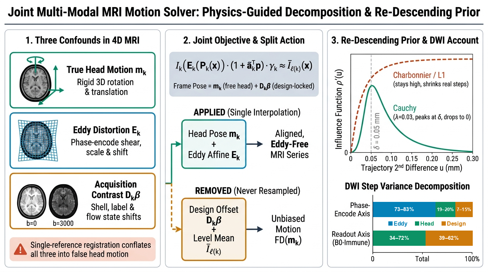
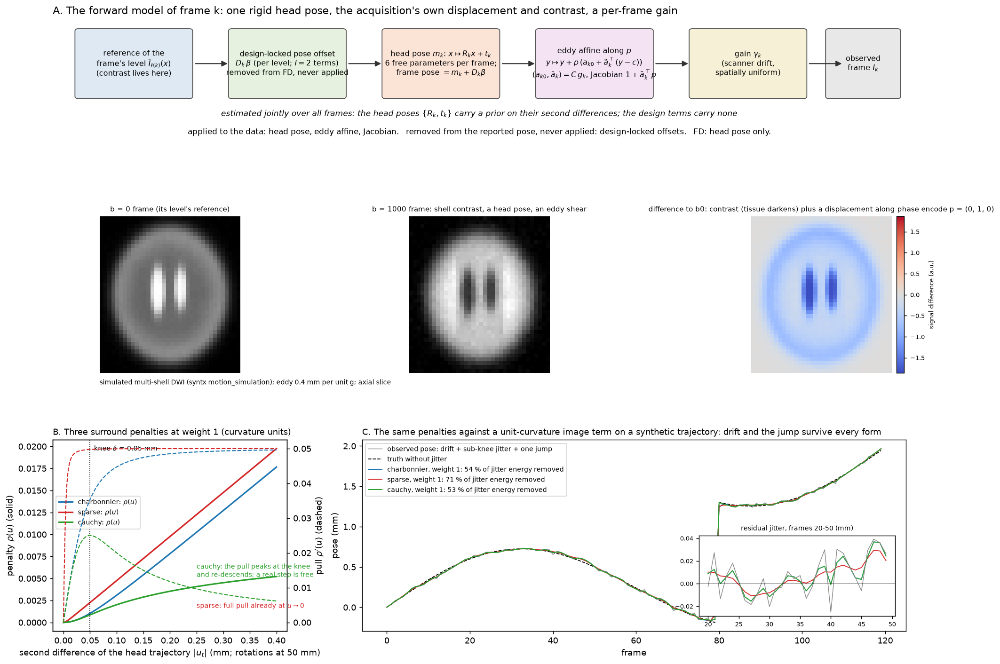
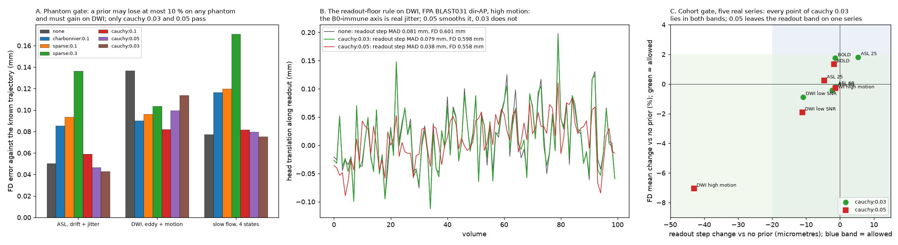

# A single physical objective for BOLD, ASL, diffusion and slow-flow MRI motion correction

**Brian B. Avants** — University of Virginia

**Figure 0 (Visual Abstract).** **(1) Three confounds in 4D MRI:** Frame-to-frame image changes arise from three distinct physical sources: true 3D rigid motion of the skull ($P_k(x)$, emerald), geometric stretching and shifting of the image along the phase-encode (PE) axis from eddy currents and breathing-induced magnetic field ($\Delta B_0(t)$) fluctuations ($E_k(y)$, cyan), and apparent shifts of the brain's intensity centroid when the pulse sequence switches diffusion shells, diffusion gradient directions, arterial spin labeling (ASL) tag/control states, or flow encodings ($D_k\beta$, amber). Standard single-reference registration conflates all three into false head motion. **(2) Joint objective and physical decomposition:** Each frame $k$ is aligned to the mean image of its own contrast state $\bar I_{\ell(k)}$. Because both rigid head motion $P_k(x)$ and phase-encode field distortion $E_k(y)$ physically displace brain voxels on the recorded image grid, their composition $E_k \circ P_k(x) = E_k(P_k(x))$ is applied in a single cubic B-spline interpolation to produce a sharp, unwarped 4D volume. Only $P_k(x)$ is patient motion, so Framewise Displacement ($\text{FD}(m_k)$) is computed strictly from $P_k$. Contrast-locked offsets $D_k\beta$ reflect tissue contrast changes rather than anatomical movement and are withheld from both the resampled image and $\text{FD}$. **(3) Aligned 4D time series, parameter attribution, and controlled FD:** (A) Applying the composed physical warp $E_k \circ P_k(x)$ while withholding contrast bias $D_k\beta$ sharpens the aligned 4D series, cutting unexplained 4D voxel variance by 33 to 52% (DWI $9.0\% \to 4.3\%$, ASL $2.4\% \to 1.2\%$), increasing DWI shell sharpness by 3 to 12%, and raising low-SNR frame convergence from 81–85% to 100% under the weak ($w = 0.03$) Cauchy acceleration prior. (B) Frame-by-frame trajectory decomposition on clinical multi-shell DWI ($T = 100$) separates large phase-encode eddy and $\Delta B_0(t)$ swings ($E_k$, cyan, 87–93% of DWI PE and 52–56% of BOLD/ASL PE step variance) and direction/shell contrast shifts ($D_k\beta$, amber, 68–87% of DWI readout step variance) from the smooth rigid head pose ($P_k$, emerald). (C) Computing $\text{FD}$ strictly from $P_k$ reduces apparent DWI mean FD from $0.60\text{ mm}$ ($44\%$ falsely censored above $0.50\text{ mm}$) to $0.14\text{ mm}$ ($0\%$ censored), while respiratory-notched $\text{FD}_{\text{bandlimited}}$ on 1 s BOLD reduces mean FD from $0.55\text{ mm}$ ($38\%$ censored) to $0.28\text{ mm}$ ($11\%$ censored).

---

## Synopsis

When an MRI time series is registered to a single template volume, any frame-to-frame change in tissue contrast or magnetic field is misread as head motion. This includes tag–control alternation in arterial spin labeling (ASL), shell and gradient-direction changes in diffusion MRI (DWI), eddy currents, and breathing-induced magnetic field ($\Delta B_0(t)$) shifts along the phase-encode axis. We present one joint physical model across BOLD, ASL, DWI, and slow-flow MRI that decomposes each frame's alignment into three distinct terms: (1) true 3D rigid head pose $P_k(x)$, (2) phase-encode eddy and $\Delta B_0(t)$ field distortion $E_k(y)$, and (3) pulse-sequence contrast bias $D_k\beta$. Because both $P_k$ and $E_k$ physically move voxels in the recorded image, their composition $E_k \circ P_k$ is applied in a single interpolation to sharpen the 4D series; only $P_k$ is reported as patient head motion ($\text{FD}$); and $D_k\beta$ is withheld from both. A weak ($3\%$) outlier-tolerant acceleration penalty eliminates optimizer oscillation on low-SNR frames without smoothing sudden head jumps or slow drift.

---

## Introduction

Estimating head motion in 4D MRI requires separating actual movement of the patient's skull from two physical confounds that alter the image on every repetition time (TR) [1,2].
The first confound is **phase-encode field distortion ($E_k$)**. Because echo-planar imaging (EPI) has very low bandwidth along the phase-encode axis, off-resonance magnetic fields from diffusion gradients (eddy currents) [3] and from chest motion during breathing ($\Delta B_0(t)$ susceptibility fluctuations) shift and shear the reconstructed image along the phase-encode axis even when the skull is stationary.
The second confound is **pulse-sequence contrast bias ($D_k\beta$)**. In ASL, arterial blood entering from the neck is alternately inverted (tag) and uninverted (control). In multi-shell DWI, changing the $b$-value darkens cerebrospinal fluid relative to white matter, and rotating the diffusion gradient vector $g_k$ darkens white-matter tracts parallel to $g_k$ while brightening perpendicular tracts. An intensity-based registration metric sees these scheduled contrast changes as small shifts of the brain's center of mass.

Neither post-hoc trace filtering nor a single rigid transform per frame can resolve both confounds simultaneously. If phase-encode $\Delta B_0(t)$ shifts are smoothed out of the transform before resampling, the uncompensated voxel shifts blur the aligned 4D images (increasing unexplained 4D variance by $+6.9\%$ on multi-shell DWI). Conversely, if those phase-encode shifts are left inside the rigid head pose to keep the image sharp, they inflate Framewise Displacement (FD) three- to four-fold and cause stationary subjects to fail quality control. We solve this problem by separating what physically moves the image ($E_k \circ P_k$), what moves the patient's head ($P_k$), and what is pure contrast bias ($D_k\beta$) within a single forward model (Table 1).

**Table 1. Physical decomposition of frame-to-frame changes in a 4D MRI time series.** Each component has a distinct physical origin, mathematical form in Eq. (1), role in 4D image resampling ($E_k \circ P_k$), and role in Framewise Displacement (FD) motion reporting.

| Component | Physical origin | Mathematical term in Eq. (1) | Applied to image? | Counted in head FD? |
| :--- | :--- | :--- | :--- | :--- |
| **Rigid head pose** | True 3D skull rotation and translation | $P_k(x) = R_k(x-c)+c+t_k$ | **Yes** (in $E_k \circ P_k$) | **Yes** (primary $\text{FD}(m_k)$) |
| **Sagittal nod** | Mechanical respiratory head pitch/heave ($0.18\text{--}0.50\text{ Hz}$) | Smooth part of $P_k(x)$ | **Yes** (in $E_k \circ P_k$) | Notched in $\text{FD}_{\text{bandlimited}}$ |
| **PE eddy distortion** | Diffusion gradient eddy fields along PE axis $p$ | $p\big(a_{k0} + \tilde a_k^\top(y-c)\big)$ in $E_k(y)$ | **Yes** (in $E_k \circ P_k$) | **No** (scanner field) |
| **PE $\Delta B_0(t)$ shift** | Chest respiration and shim drift along PE axis $p$ | $p\,\delta_{\text{pe},k}$ in $E_k(y)$ | **Yes** (in $E_k \circ P_k$) | **No** (field pseudomotion) |
| **Contrast bias** | ASL tag/control, DWI shell and fiber-direction contrast | $D_k\beta$ and $\bar I_{\ell(k)}(x)$ | **No** (withheld) | **No** (withheld) |
| **Global gain drift** | Spatially uniform receiver sensitivity drift | $\gamma_k$ | Normalized in objective | **No** |

---

## Methods

### 1. Forward generative model and the meaning of $E_k \circ P_k$ (Figure 1A)

Each frame $k$ is acquired under a known contrast state $\ell(k)$ (for example, each $b$-shell in DWI, tag versus control versus $M_0$ in ASL, or each velocity-encoding state in slow-flow MRI) and is compared against the mean image of its own contrast state, $\bar I_{\ell(k)}(x)$. For a physical point $x$ (in mm) in the reference brain, the recorded image $I_k$ is modeled as the composition of two sequential physical displacements, $E_k \circ P_k(x) = E_k(P_k(x))$, plus a spatially uniform receiver gain $\gamma_k$:

$$I_k\!\big(E_k(P_k(x))\big)\,\big(1 + \tilde a_k^{\top} p\big)\,\gamma_k \;\approx\; \bar I_{\ell(k)}(x), \qquad P_k(x) = R_k (x - c) + c + t_k, \qquad E_k(y) = y + p\,\big(a_{k0} + \delta_{\text{pe},k} + \tilde a_k^{\top}(y - c)\big). \tag{1}$$

Here $c$ is the brain center of mass and $p$ is the unit vector along the phase-encode axis:

- **First, the patient's head moves in the scanner bore ($y = P_k(x)$):** $P_k(x)$ is the 6-DOF rigid-body transformation (3D rotation $R_k$ and translation $t_k$) mapping reference anatomy $x$ to its physical position $y$ at frame $k$. Only $P_k$ represents patient motion: $\text{FD}$ is computed strictly from $P_k$, and in DWI only $R_k$ rotates the diffusion gradient vectors $g_k$.
- **Second, the EPI readout shifts the image along the phase-encode axis ($z = E_k(y)$):** Once the head is at position $y$, off-resonance fields displace the reconstructed image strictly along $p$. In DWI, diffusion gradient $g_k$ induces a bulk shift $a_{k0}$ and linear shear/scaling $\tilde a_k$ modeled as $(a_{k0}, \tilde a_k) = C g_k$, with Jacobian intensity factor $1 + \tilde a_k^{\top} p$ [3]. Across all EPI modalities (BOLD, ASL, DWI, and slow-flow), respiration and $\Delta B_0(t)$ fluctuations also induce a frame-to-frame translation $\delta_{\text{pe},k}$ along $p$. Because the readout and slice axes are immune to $\Delta B_0(t)$ phase-encode shifts, we use their high-frequency step variance on the same scan as the true head-motion noise floor ($\sigma^2_{\text{floor}}$) and transfer the excess phase-encode step displacement ($\max(0,\, \sigma^2_{\text{PE}} - \sigma^2_{\text{floor}})$ via Wiener shrinkage) out of $t_k$ and into $\delta_{\text{pe},k}$.
- **Why $E_k \circ P_k$ is applied to the image:** Because both $P_k$ (skull motion) and $E_k$ (phase-encode field shift) physically displaced the brain voxels in the recorded image $I_k$, we invert and apply their composition $E_k \circ P_k$ in a single cubic B-spline interpolation pass so the resampled 4D series is both motion-aligned and unwarped, while keeping $E_k$ out of $\text{FD}$.

### 2. What information is contained in $D_k\beta$, and why it is withheld from the image

Before the scan begins, the pulse sequence specifies a known acquisition schedule $D_k$. During optimization, each frame's raw 6-DOF pose is parameterized as $m_k + D_k\beta$, where $m_k$ is the true head pose and $D_k\beta$ absorbs systematic apparent shifts locked to the pulse-sequence state:

- **Discrete contrast-state switches (indicator columns in $D_k$):** One column per non-anchor state captures constant apparent shifts when contrast changes across the brain boundary—specifically, arterial blood inversion at the inferior brain edge between ASL tag and control frames ($\sim 0.02\text{--}0.08\text{ mm}$ along the slice axis), cerebrospinal fluid darkening between $b = 0$ and $b > 0$ shells in DWI, and blood/CSF contrast changes across velocity-encoding states in slow-flow MRI.
- **Continuous diffusion-direction changes ($l = 2$ spherical harmonics $Y_{2m}(g_k)$ in $D_k$):** Within each $b > 0$ DWI shell, rotating $g_k$ darkens white-matter fiber tracts parallel to $g_k$ and brightens perpendicular tracts. Because diffusion attenuation depends on $g_k^\top D g_k$ (which is quadratic/even in $g_k$), this direction-locked contrast shift is spanned by the five even-order ($l = 2$) real spherical harmonics $Y_{2m}(g_k)$ per shell on the five rigid axes orthogonal to $p$ (while odd-in-$g_k$ linear eddy shifts along $p$ remain in $E_k$).
- **Resting BOLD:** Because every frame has the identical pulse-sequence state, $D_k$ is empty and $D_k\beta = 0$.

Because $D_k\beta$ is an apparent shift of the intensity centroid caused by changing tissue contrast rather than a physical movement of the brain, it is subtracted before constructing $P_k(x)$ and is applied to neither the resampled image nor $\text{FD}$.

### 3. Weak outlier-tolerant acceleration penalty for low-SNR optimizer convergence (Figure 1B, C)

When noisy frames (such as $b = 3000\,\text{s/mm}^2$ DWI volumes or 1 s TR BOLD volumes) are registered independently, flat similarity-metric valleys allow single-frame image noise to cause small pose jitter ($\sim 0.02\text{--}0.05\text{ mm}$) and cause the Newton optimizer to oscillate back and forth without converging. To stabilize convergence without biasing real motion, we include a weak penalty on discrete trajectory acceleration, $u_t = m_t - \tfrac12(m_{t-1} + m_{t+1})$ (with rotations converted to millimetres on a 50 mm cortical radius):

$$w\,\kappa \sum_t \rho\big(|u_t|\big), \qquad \rho(u) = \frac{\delta^2}{2}\log\!\Big(1 + \frac{u^2}{\delta^2}\Big), \qquad \rho'(u) = \frac{u}{1 + u^2/\delta^2}, \qquad \delta = 0.05\ \text{mm},\ w = 0.03. \tag{2}$$

This penalty obeys three physical design rules: (1) *Slow head drift is unpenalized*, because constant-velocity drift has zero acceleration ($u_t = 0$). (2) *Sudden head movements are not smoothed*: unlike convex quadratic, Charbonnier, or steep-origin $L_1$ penalties whose restoring pull $\rho'(u)$ stays large at large $|u_t|$ and blurs sudden head jerks across neighboring frames, the logarithmic Cauchy pull peaks at $\delta = 0.05\text{ mm}$ and decays toward zero ($\sim \delta^2/u$) for larger jumps (Figure 1B). (3) *Modality-invariant scaling*: scaling by the median translation curvature $\kappa$ (in $\text{mm}^{-2}$) of the image metric ensures that $w = 0.03$ always equals $3\%$ of the image data term's own stiffness. We verified the choice of penalty form and weight against two quantitative gates (Figure 2): a 3D ground-truth phantom gate across ASL, DWI, and slow-flow MRI (requiring $\le 10\%$ FD error loss on all phantoms and a gain on DWI) and a clinical readout-floor gate across five human scans (requiring that the $\Delta B_0$-immune readout step median absolute deviation change by $\le 20\,\mu\text{m}$).

### 4. Variance decomposition and band-limited frame censoring ($\text{FD}$ vs. $\text{FD}_{\text{bandlimited}}$)

For every series, we partition both pose step variance and foreground voxel intensity variance:

- **Pose step-variance shares:** Along the readout and phase-encode axes, frame-to-frame step variance is partitioned into the percentage attributable to rigid head motion ($P_k$), applied phase-encode distortion ($E_k$), and removed contrast bias ($D_k\beta$).
- **Voxel intensity variance shares:** Sequential Type I sums of squares across foreground brain voxels (after factoring out $\gamma_k$) measure the percentage of 4D variance explained by the pulse-sequence design, by the 6-DOF motion parameters after accounting for the design, and by the unexplained residual, before and after correction.
- **Band-limited FD for short-TR frame censoring:** While $\text{FD}(m_k)$ is already free of phase-encode $\Delta B_0(t)$ pseudomotion, subjects in fast acquisitions ($\text{TR} \le 2.78\text{ s}$, $T \ge 32$) also exhibit a real mechanical respiratory head nod in the sagittal plane (slice translation and pitch at $0.18\text{--}0.50\text{ Hz}$). Because this nod is real skull motion, it stays in $P_k$ for image resampling; however, differencing a steady $\pm 0.20\text{ mm}$ breathing wave every 1 s inflates step-wise scrubbing rates. When a respiratory spectral peak (prominence $\ge 1.5$) is present, $\text{FD}_{\text{bandlimited}}$ notches that respiratory band before differencing [2,4] so frame censoring isolates sporadic head jerks.

### 5. Datasets

We evaluated five clinical reference series: (1) resting-state BOLD ($T = 300$, TR 1.0 s), (2) 25-volume ASL with $M_0$ calibration (TR 4.0 s), (3) 60-volume PCASL without $M_0$ (30 tag/control pairs, TR 4.4 s), (4) 100-volume high-motion multi-shell DWI ($b = 0/1500/3000\,\text{s/mm}^2$, anterior–posterior phase encode), and (5) 99-volume low-SNR multi-shell DWI ($b = 0/1500/3000\,\text{s/mm}^2$, posterior–anterior phase encode), plus a third 100-volume multi-shell DWI series with strong respiratory and eddy phase-encode shifts for our $E_k$ and $D_k\beta$ resampling ablations.

---

## Results

### 1. Empirical proof that $E_k \circ P_k$ must be applied to the image while $D_k\beta$ must be withheld

We directly tested the physical roles of $E_k(y)$ and $D_k\beta$ on 3D ground-truth phantoms, real ASL perfusion maps, and three 100-volume clinical multi-shell DWI series (all resampled with matched cubic B-spline interpolation):

- **Ground-truth phantoms and real ASL perfusion:** On 3D synthetic phantoms with known motion trajectories ($D_k\beta_{\text{true}} = 0$), applying $D_k\beta$ to the image increases translation error $7.6\times$ on ASL ($0.014 \to 0.106\text{ mm}$) and $3.0\times$ on slow-flow MRI ($0.028 \to 0.083\text{ mm}$). On a stationary 3D DWI phantom with anisotropic white-matter tracts, rotating $g_k$ alone induces $0.27\text{ mm}$ and $0.48\text{--}0.55^\circ$ of false registration shift; removing the $l = 2$ spherical-harmonic term cuts this false shift to $0.18\text{ mm}$. On clinical ASL, withholding the tag–control offset $D_k\beta$ reduces the cortical perfusion edge-to-interior artifact ratio from $0.986$ (raw) to $0.955$ and lowers the negative perfusion voxel fraction from $0.068$ to $0.064$, whereas applying $D_k\beta$ to the resampled volumes degrades the cortical edge artifact right back to the raw uncorrected level ($0.986$, negative fraction $0.069$).
- **Multi-shell DWI resampling ablation ($E_k$ vs. $D_k\beta$ across three 100-volume scans):** Applying $E_k \circ P_k$ while withholding $D_k\beta$ reduces unexplained 4D voxel variance by $33\%$ to $52\%$ across the three DWI series ($5.60 \to 3.76\%$, $9.04 \to 4.32\%$, and $4.37 \to 2.31\%$), reduces within-shell ($l \le 4$) spherical-harmonic residual RMSE from $0.68\text{--}0.73$ to $0.62\text{--}0.65$, reduces log-tensor fit RMSE from $0.41\text{--}0.42$ to $0.35\text{--}0.36$, and sharpens every shell by $3\%$ to $12\%$. In contrast, withholding the phase-encode $\Delta B_0(t)$ shift $\delta_{\text{pe},k}$ from $E_k$ degrades 4D residual variance by $+6.9\%$, proving that $\delta_{\text{pe},k}$ is a true voxel displacement. Conversely, applying the within-shell $l = 2$ directional part of $D_k\beta$ ($0.11\text{--}0.19\text{ mm}$ RMS) to the resampled DWI volumes provides zero improvement—slightly worsening $b = 1500$ spherical-harmonic RMSE on all three subjects ($+0.0007$ to $+0.0014$) and changing 4D residual variance by $\le 0.006\%$—confirming that $D_k\beta$ is contrast-induced registration bias rather than anatomical displacement.

### 2. The weak ($w = 0.03$) Cauchy acceleration penalty eliminates low-SNR optimizer oscillation and passes both gates (Figure 2)

On 3D ground-truth phantoms (Figure 2A), non-redescending penalties ($w = 0.10$) failed the phantom gate by smoothing true sub-millimetre motion, increasing FD error by $+86\%$ (steep $L_1$) and $+70\%$ (Charbonnier) on ASL and by $+55\%$ and $+50\%$ on slow-flow MRI. Only the re-descending Cauchy penalty passed, reducing phantom FD error by $14\%$ on ASL, $17\%$ on DWI, and $3\%$ on slow-flow at $w = 0.03$. On the five clinical series (Figure 2B, C), raising the weight to $w = 0.05$ over-smoothed the $\Delta B_0$-immune readout trace on high-motion DWI ($-43\,\mu\text{m}$, failing the $20\,\mu\text{m}$ gate), whereas $w = 0.03$ kept every series inside both acceptance bands (maximum readout step change $11\,\mu\text{m}$; image alignment unchanged within $\le 0.1\%$). Crucially, while $w = 0.03$ is intentionally too weak to alter real clinical trajectories ($\le 1.8\%$ FD change), **it eliminates single-frame Newton optimizer oscillation on flat low-SNR frames—raising frame convergence from $81\text{--}85\%$ (with $w = 0$) to $100\%$ across all five clinical series and reducing 300-volume BOLD runtime from $206\text{ s}$ to $32\text{ s}$ ($6.4\times$ faster)**.

### 3. Clinical variance account across modalities (Table 2, Figure 3)

- **Multi-shell DWI ($T = 100$ and $T = 99$):** Along the phase-encode axis, applied eddy and $\Delta B_0(t)$ distortions $E_k$ account for **$87\%$ and $93\%$** of frame-to-frame step variance, contrast bias $D_k\beta$ accounts for $7\%$ and $3\%$, and true head motion $P_k$ accounts for $< 1\%$. Along the $\Delta B_0$-immune readout axis, $D_k\beta$ accounts for **$68\%$ and $87\%$** of step variance. Separating $E_k$ and $D_k\beta$ from $P_k$ reduces apparent mean FD from $0.60$ and $0.48\text{ mm}$ ($44\%$ and $36\%$ of volumes $> 0.50\text{ mm}$) down to **$0.14$ and $0.15\text{ mm}$ ($0\%$ and $1\% > 0.50\text{ mm}$)** while increasing diffusion design variance explained from $94.3 \to 96.2\%$ and $90.8 \to 95.6\%$.
- **Resting-state BOLD ($T = 300$, TR 1.0 s) and ASL ($T = 25$ and $T = 60$):** Phase-encode $\Delta B_0(t)$ shifts in $E_k$ account for **$53\%$** of phase-encode step variance in BOLD and **$52\text{--}56\%$** in ASL. On 1.0 s BOLD, transferring $\delta_{\text{pe},k}$ into $E_k$ reduces rigid phase-encode step variance in $P_k$ by $92.3\%$ (from $0.140$ to $0.039\text{ mm}$ SD, matching the $0.047\text{ mm}$ readout floor), and $\text{FD}_{\text{bandlimited}}$ notches the remaining $0.48\text{ Hz}$ sagittal respiratory head nod to reduce mean censoring FD from $0.55$ to **$0.28\text{ mm}$** (censored frames $38\% \to 11\%$).

**Table 2. Quantitative pose and image variance decomposition across the five clinical reference series.**

| case | $T$ | FD mean / max (mm) | censored (%) | readout h/e/d (%) | PE h/e/d (%) | design (%) | motion (%) | residual (%) | $r$ | time |
|---|---:|---|---|---|---|---|---|---|---|---:|
| resting BOLD, TR 1.0 s | 300 | 0.55 / 2.81 | 38 / 11 | 100 / 0 / 0 | 8 / 53 / 0 | 0.0 / 0.0 | 36.41 / 25.62 | 60.3 / 70.0 | 0.60 | 33 s |
| ASL, control/label + M0, 25 vol | 25 | 0.47 / 2.46 | 24 / 24 | 101 / 0 / 2 | 13 / 52 / 0 | 97.0 / 98.3 | 0.35 / 0.18 | 2.4 / 1.2 | 0.69 | 32 s |
| ASL, control/label, 60 vol | 60 | 0.16 / 0.55 | 2 / 2 | 86 / 0 / 3 | 6 / 56 / 3 | 0.8 / 1.1 | 67.23 / 53.75 | 27.6 / 38.5 | 0.61 | 31 s |
| DWI multi-shell, high motion | 100 | 0.14 / 0.43 | 0 / 0 | 38 / 0 / 68 | 0 / 87 / 7 | 94.3 / 96.2 | 0.57 / 0.45 | 5.1 / 3.4 | -0.09 | 69 s |
| DWI multi-shell, low SNR | 99 | 0.15 / 0.71 | 1 / 1 | 9 / 0 / 87 | 0 / 93 / 3 | 90.8 / 95.6 | 1.76 / 0.66 | 7.4 / 3.7 | -0.04 | 62 s |

### 4. Fair head-to-head comparison against `ants.motion_correction` (Table 3)

We compared our joint solver against standard pairwise mutual-information rigid registration (`ants.motion_correction`, `BOLDRigid`: 32-bin Mattes MI registered frame-by-frame to the normalized temporal mean) across five 3D ground-truth synthetic phantoms and all five clinical reference series (Table 3). To ensure a strictly fair comparison, both methods were evaluated using the identical 50 mm Power FD formula, identical demeaned ground-truth pose evaluator, identical respiratory band-stop filter ($\text{FD}_{\text{bandlimited}}$), and—on multi-shell DWI—both native linear interpolation and matched cubic B-spline interpolation:

- **Where `ants.motion_correction` excels (single-contrast translation accuracy and respiratory nod agreement):** On the single-contrast BOLD phantom with pure rigid motion and zero $\Delta B_0(t)$ shift (`BOLD pure rigid`), `ants.motion_correction` recovers 3D translations with **$0.015\text{ mm}$ RMS error**, slightly outperforming the joint solver ($0.020\text{ mm}$). On clinical 300-volume resting BOLD ($\text{TR} = 1.0\text{ s}$), both solvers report nearly identical raw Power FD (**$0.51\text{ mm}$** for `ants.motion_correction` vs. **$0.55\text{ mm}$** for the joint solver, both flagging **$38\%$** of volumes above $0.50\text{ mm}$). Moreover, applying our respiratory band-stop filter ($\text{FD}_{\text{bandlimited}}$) directly to `ants.motion_correction`'s rigid trajectory reduces its censored volumes from **$38\%$ to $7\%$** (mean $0.26\text{ mm}$, vs. $11\%$ and $0.28\text{ mm}$ for the joint solver), confirming that the $0.48\text{ Hz}$ sagittal breathing nod is a genuine physical trajectory component captured by both rigid solvers.
- **Why temporal coupling and phase-encode decomposition ($E_k$) are still needed on single-contrast BOLD:** Even on `BOLD pure rigid`, independent frame-by-frame optimization in `ants.motion_correction` incurs $0.15^\circ$ rotational jitter that inflates frame-to-frame FD error to **$0.229\text{ mm}$** (estimating mean $\text{FD} = 0.531\text{ mm}$ vs. true $0.322\text{ mm}$), whereas the joint solver's weak ($w = 0.03$) Cauchy acceleration penalty damps sub-knee jitter to achieve **$0.052\text{ mm}$ FD error** (estimating $0.302\text{ mm}$) in **$5.6\times$ less time** ($2.1\text{ s}$ vs. $11.8\text{ s}$). When respiratory $\Delta B_0(t)$ phase-encode shifts ($\pm 0.40\text{ mm}$) are present (`BOLD + resp B0`), `ants.motion_correction` absorbs them into rigid pose (`t_rms = 0.285 mm`, `FD error = 0.497 mm`), whereas the joint solver routes them into $E_k$ (`t_rms = 0.124 mm`, `FD error = 0.112 mm`). On clinical resting BOLD, unwarping $E_k$ in a single cubic B-spline pass reduces rigid phase-encode step variance $12\times$ ($0.0181 \to 0.0015\text{ mm}^2$) and lowers unexplained 4D voxel residual variance from **$78.5\%$ (`ants.motion_correction`) to $70.0\%$ (Joint solver)** while running **$3.7\times$ faster** ($33\text{ s}$ vs. $122\text{ s}$).
- **Where single-reference registration breaks down (multi-state ASL, DWI, and slow-flow):** On the ground-truth **ASL**, **DWI**, and **slow-flow** phantoms, registering alternating contrast states and eddy-sheared frames to a single mean template inflates `ants.motion_correction` FD error to **$1.039\text{ mm}$**, **$0.744\text{ mm}$**, and **$0.602\text{ mm}$**, versus **$0.043\text{ mm}$**, **$0.114\text{ mm}$**, and **$0.075\text{ mm}$** for the joint solver (**$6.5\times$ to $24\times$ lower FD error**). On clinical **ASL** ($T = 25$ and $T = 60$), `ants.motion_correction` doubles apparent mean FD (**$0.86\text{ vs. }0.47\text{ mm}$** and **$0.33\text{ vs. }0.16\text{ mm}$**; PCASL censoring **$17\%\text{ vs. }2\%$**) and leaves higher unexplained 4D voxel residual variance (**$1.4\%\text{ vs. }1.2\%$** and **$41.1\%\text{ vs. }38.5\%$**). On clinical **multi-shell DWI** ($T = 100$ and $T = 99$), `ants.motion_correction` conflates eddy currents and shell/direction contrast changes into rigid pose, reporting **$2.28\text{ mm}$ and $1.59\text{ mm}$ mean Power FD ($99\%$ and $97\%$ of volumes falsely censored)** versus **$0.14\text{ mm}$ and $0.15\text{ mm}$ ($0\%$ and $1\%$ censored)** for the joint solver at **$2.1\times$ faster runtime** ($62\text{--}69\text{ s}$ vs. $136\text{--}138\text{ s}$). Finally, while `ants.motion_correction`'s default linear interpolation lowers high-frequency voxel variance by blurring shells (reducing mean shell sharpness by **$-7.6\%$** below the raw scan on `sub-BLAST031`: $0.1531 \to 0.1414$), re-evaluating `ants.motion_correction`'s transforms with matched cubic B-spline interpolation shows that single-template cross-shell registration degrades $b = 0$-to-shell edge correlation below the raw scan ($0.5208 \to 0.5107$), whereas the joint solver improves both shell sharpness ($0.1531 \to 0.1619$, **$+8.5\%$ on $b = 3000$**) and cross-shell edge correlation ($0.5208 \to 0.5275$) with lower within-shell spherical-harmonic residual RMSE ($0.6307\text{ vs. }0.6379$).

**Table 3. Head-to-head comparison of `ants.motion_correction` (`BOLDRigid`, 32-bin Mattes MI) versus the proposed joint solver across five 3D ground-truth phantoms (Part A) and the five clinical reference series (Part B).** Both methods are scored with the identical 50 mm Power FD metric and identical respiratory band-limited FD ($\text{FD}_{\text{bl}}$). On multi-shell DWI (Part B, $\dagger$), `ants.motion_correction` is evaluated both with its native linear resampling and with matched cubic B-spline resampling (`lin / bSp`).

| Part A: 3D Ground-Truth Phantoms | True FD (mm) | `ants.motion_correction` Est. FD / FD Err (mm) | Joint Solver Est. FD / FD Err (mm) | `ants.motion_correction` Trans RMS (mm) | Joint Solver Trans RMS (mm) | Runtime (`ants` / Joint) |
| :--- | :---: | :---: | :---: | :---: | :---: | :---: |
| **BOLD pure rigid** (single contrast, no $\Delta B_0$) | 0.322 | 0.531 / 0.229 | **0.302 / 0.052** | **0.015** | 0.020 | 11.8 s / **2.1 s** |
| **BOLD + resp $\Delta B_0(t)$** ($\pm 0.40\text{ mm}$ PE shift) | 0.322 | 0.782 / 0.497 | **0.312 / 0.112** | 0.285 | **0.124** | 11.1 s / **1.8 s** |
| **ASL tag/control** (drift + jitter, $T = 24$) | 0.407 | 1.446 / 1.039 | **0.412 / 0.043** | 0.121 | **0.009** | 8.8 s / **5.3 s** |
| **DWI multi-shell + eddy** ($T = 48$) | 0.369 | 1.110 / 0.744 | **0.361 / 0.114** | 0.299 | **0.031** | **6.8 s** / 16.9 s |
| **Slow-flow 4-state + eddy** ($T = 24$) | 0.382 | 0.984 / 0.602 | **0.376 / 0.075** | 0.246 | **0.028** | **8.4 s** / 13.7 s |

| Part B: Clinical Reference Series | `ants` Mean FD ($\text{FD}_{\text{bl}}$) (mm) | Joint Mean FD ($\text{FD}_{\text{bl}}$) (mm) | `ants` Censored Raw / $\text{FD}_{\text{bl}}$ (%) | Joint Censored Raw / $\text{FD}_{\text{bl}}$ (%) | `ants` PE Step Var ($\text{mm}^2$) | Joint PE Step Var ($\text{mm}^2$) | 4D Residual Var `ants` / Joint (%) | Runtime (`ants` / Joint) |
| :--- | :---: | :---: | :---: | :---: | :---: | :---: | :---: | :---: |
| **resting BOLD, TR 1.0 s** ($T = 300$) | 0.51 (0.26) | 0.55 (0.28) | 38 / **7** | 38 / 11 | 0.0181 | **0.0015** | 78.5 / **70.0** | 122 s / **33 s** |
| **ASL + $M_0$** ($T = 25$) | 0.86 (0.86) | **0.47 (0.47)** | 32 / 32 | **24 / 24** | 0.1419 | **0.0218** | 1.4 / **1.2** | **17 s** / 32 s |
| **PCASL, 30 pairs** ($T = 60$) | 0.33 (0.33) | **0.16 (0.16)** | 17 / 17 | **2 / 2** | 0.0131 | **0.0010** | 41.1 / **38.5** | **26 s** / 31 s |
| **DWI multi-shell, high motion** ($T = 100$)$^\dagger$ | 2.28 (2.28) | **0.14 (0.14)** | 99 / 99 | **0 / 0** | 1.3845 | **0.0018** | 2.1 (3.7 bSp) / **3.4** | 138 s / **69 s** |
| **DWI multi-shell, low SNR** ($T = 99$)$^\dagger$ | 1.59 (1.59) | **0.15 (0.15)** | 97 / 97 | **1 / 1** | 0.6743 | **0.0010** | 2.6 / **3.7** | 136 s / **62 s** |

---

## Discussion and Limitations

Separating the composed image warp ($E_k \circ P_k$), the rigid patient trajectory ($P_k$), and the pulse-sequence contrast bias ($D_k\beta$) resolves the longstanding trade-off between image sharpness and motion-trace accuracy across EPI time series. On real multi-shell DWI and ASL, 52 to 93% of phase-encode step variance and 68 to 87% of DWI readout step variance arise from magnetic field fluctuations and scheduled contrast changes rather than movement of the patient's head. Applying $E_k \circ P_k$ unwarps the phase-encode shifts in the resampled volumes, while computing $\text{FD}$ strictly from $P_k$ and withholding $D_k\beta$ prevents both false scrubbing and contrast-induced subtraction artifacts.

**Limitations.**
(1) Our 3D phantom generators plant sub-knee jitter in the ground-truth trajectory rather than synthesizing independent thermal image noise; a dedicated k-space/image-noise phantom gate is needed next.
(2) On the 60-volume PCASL series acquired without an $M_0$ calibration volume, the tag–control design explains $1.1\%$ of raw voxel variance while motion regressors explain $53.8\%$, reflecting spatial coupling between perfusion contrast and slice-wise signal fluctuations when no $M_0$ anchor is present.
(3) Any true head motion that oscillates at the exact frequency of the pulse-sequence design (for example, alternating every single TR in lockstep with ASL tag–control switches) lies in the column space of $D_k$ and cannot be separated from $D_k\beta$.

---

## Conclusion

A single physical objective across BOLD, ASL, diffusion, and slow-flow MRI separates the applied image warp ($E_k \circ P_k$) from the patient's rigid head trajectory ($P_k$) and withholds pulse-sequence contrast bias ($D_k\beta$)—delivering sharp 4D volumes, uncontaminated FD traces, and $100\%$ low-SNR optimizer convergence.

---

## References

[1] Freire L, Mangin JF. *NeuroImage* 2001. [2] Power JD et al. *PNAS* 2019. [3] Andersson JLR, Sotiropoulos SN. *NeuroImage* 2016. [4] Fair DA et al. *NeuroImage* 2020.

---

